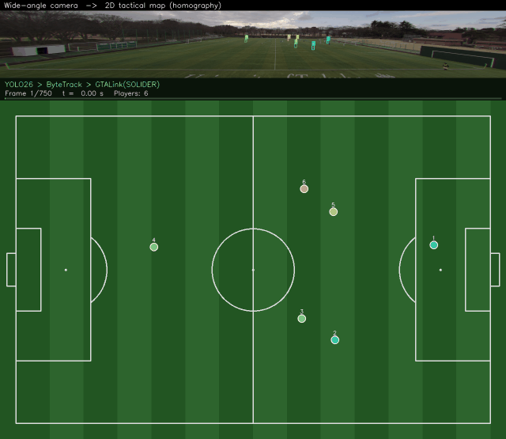
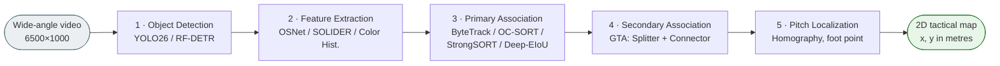
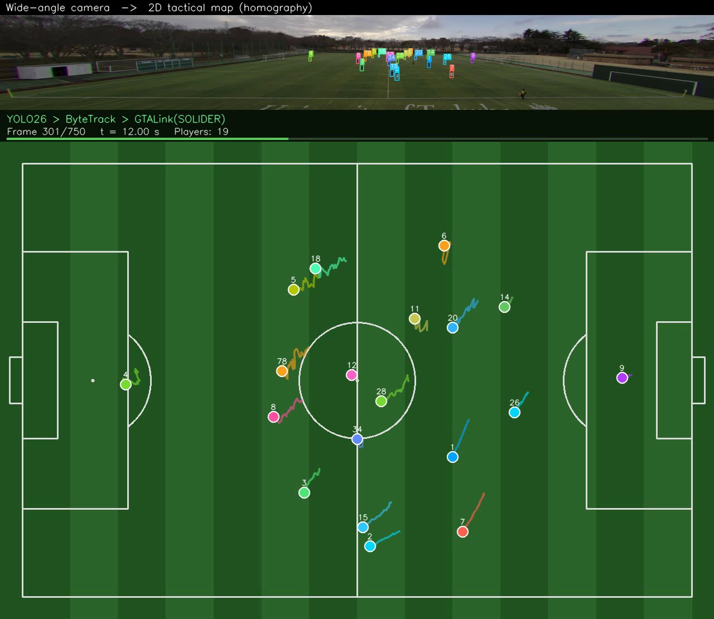

<div align="center">

# E2ESoTrack

### End-to-End Soccer Tracking and Refinement Architecture for 2D Soccer Match Reconstruction from Broadcast Videos

**Thi Hong Hanh Pham · Phuong Nam Nguyen · Viet Hang Duong**<br>
University of Information Technology, VNU-HCM, Ho Chi Minh City, Vietnam

*Accepted at CSoNet 2026, The 15th International Conference on Computational Science and Network Intelligence (Springer LNCS)*




*Wide-angle broadcast frame with track IDs (top) → player positions on a 105 × 68 m pitch (bottom). Same colour = same ID.*

</div>

---

## Highlights

- **One video in, one tactical map out.** A five-module tracking-by-detection pipeline turns raw wide-angle footage into per-player pitch coordinates. No GPS or GNSS hardware is needed.
- **Modular benchmark.** 2 detectors × 4 extractors × 4 online trackers × GTA on/off, evaluated on the SoccerTrack wide-view subset (11-vs-11, 8K cameras).
- **Strong gains over the baseline.** The optimal configuration **YOLO26 → ByteTrack → GTA (SOLIDER)** reaches **MOTA 68.27 / IDF1 65.90 / HOTA 31.34**, about **22× the MOTA** of a YOLOv5 + OSNet + DeepSORT baseline.
- **Evaluated in metres, against GNSS.** Two pitch-level metrics, *Pitch-HOTA* and *E<sub>1:1</sub>*, compare reconstructed trajectories with wearable GNSS. The pipeline reaches **76 % of the achievable Pitch-HOTA**, with trajectory error only **1.0 m above the projection floor**.

## Pipeline



| Module | What it does | Optimal choice |
|---|---|---|
| Object Detection | Finds players in each frame | YOLO26 (`imgsz=1600`, conf 0.4, IoU 0.5) |
| Feature Extraction | Appearance embedding per box for online matching | *None* (online); SOLIDER is used inside GTA |
| Primary Data Association | Frame-to-frame linking with a Kalman filter + IoU | ByteTrack (`lambda_iou=1.0`) |
| Secondary Data Association | Offline: splits mixed-identity tracklets (DBSCAN) and re-links broken ones | GTA with SOLIDER (`merge_dist_thres=0.35`) |
| Pitch Localization | Projects the bottom-centre of each box to pitch metres with a homography (65 landmarks, RANSAC) | `fisheye_keypoints.json` |

## Results

### Multi-object tracking on the test set (6 videos, 1800–1980 s)

| Pipeline | Configuration | MOTA ↑ | IDF1 ↑ | HOTA ↑ | IDs ↓ | FP ↓ | FN ↓ |
|---|---|:-:|:-:|:-:|:-:|:-:|:-:|
| **E2ESoTrack (optimal)** | YOLO26 → ByteTrack → GTA (SOLIDER) | **68.27** | 65.90 | **31.34** | 12.33 | **715.5** | **4508.7** |
| E2ESoTrack (fast) | YOLO26 → ByteTrack | 68.33 | 66.26 | 28.40 | 0.83 | – | – |
| Baseline | YOLOv5 (COCO) → OSNet → DeepSORT | 3.07 | 14.38 | 5.96 | 4 | 1642 | 14348 |
| Baseline (trained) | YOLOv5 (retrained) → OSNet → DeepSORT | 54.00 | 45.50 | 13.79 | 34 | 2112 | 5443 |

The fast configuration (no GTA) runs at **≈70 s per 30 s video** on our GPU, about 68 % faster than the optimal one.

### Pitch localization against GNSS (6 held-out videos, 720–900 s)

| Pipeline | Pitch-HOTA ↑ | E<sub>1:1</sub> (m) ↓ |
|---|:-:|:-:|
| *Oracle (GT boxes)* | *64.09* | *3.53* |
| Baseline | 16.34 | 5.34 |
| Baseline (trained) | 35.22 | 6.01 |
| YOLO26 + ByteTrack | 47.60 | 4.80 |
| **YOLO26 + ByteTrack + GTA** | **48.88** | **4.53** |

- **Pitch-HOTA** is HOTA computed on pitch positions, with similarity `max(0, 1 − d / 10 m)`. It rewards being in the right place *and* keeping the right identity.
- **E<sub>1:1</sub>** assigns one predicted track to each player for the whole clip. A matched position costs its distance in metres, and each miss or false track costs `c/2` (GOSPA style, `c = 10 m`).
- **Oracle** projects ground-truth boxes through the same homography. It is the floor set by GNSS noise and the projection itself.

E2ESoTrack beats both baselines on both metrics in all six videos.

## Repository structure

```
.
├── PipelineMOT/                 # E2ESoTrack (main method)
│   ├── demo.py                  # ★ raw video → tracking → 2D tactical-map video
│   ├── demo.ipynb               # ★ step-by-step walkthrough of demo.py (with outputs)
│   ├── analysis.ipynb           # ★ why each module: detector / extractor / tracker / GTA comparisons
│   ├── test.ipynb               # benchmark runner: every detector × extractor × tracker × GTA (Tables 1–4)
│   ├── save_pitch_tracks.py     # tracks on the 6 GNSS clips → Output/pitch_eval/
│   ├── eval_pitch.py            # pitch localization vs GNSS (Table 5)
│   ├── models/                  # (not tracked) best_yolo26.pt, best_rf_detr.pth, swin_small_converted.pth
│   └── src/
│       ├── detector.py          # YOLO26 | RF-DETR
│       ├── feature_extractor.py # OSNet | SOLIDER | color histogram
│       ├── osnet.py, swin_transformer.py
│       ├── tracker.py           # unified wrapper over tracker_alg/
│       ├── tracker_alg/         # bytetrack, ocsort, strongsort, deepeiou, kalman_filter
│       ├── gtalink.py, tracklet.py   # GTA offline refinement
│       ├── pitch_localization.py     # homography, bbox ↔ pitch
│       ├── visualize_2d.py           # tactical map + side-by-side rendering
│       ├── compute_metrics.py        # MOTA / MOTP / IDF1 / HOTA
│       ├── pitch_eval.py             # GNSS alignment, Pitch-HOTA, E_1:1
│       └── utils.py                  # run_mot / run_pipeline
├── SoccerMOT_Baseline/          # YOLOv5 → OSNet → DeepSORT baseline + analysis.ipynb (see its README)
├── results/                     # all numbers behind the paper tables (CSV, per video)
├── Training/                    # train_yolo26.py, train_rfdetr.py, train_yolo5.py, Tunning.ipynb
├── PrepareData/                 # SoccerTrack → YOLO detection / Re-ID crops
├── assets/                      # figures for this README
└── requirements.txt
```

## Installation

```bash
git clone https://github.com/HongHanh-atUIT/CS318_RECOGNITION_SOCCERTRACK_MOT.git
cd CS318_RECOGNITION_SOCCERTRACK_MOT

# PyTorch with CUDA first (choose the build for your driver: https://pytorch.org)
pip install torch torchvision --index-url https://download.pytorch.org/whl/cu126
pip install -r requirements.txt
```

Tested on Windows 11 with an RTX 3050 Laptop (4 GB), PyTorch 2.12 + CUDA 12.6 and Ultralytics 8.4.

### Data

Download the **wide-view** part of [SoccerTrack](https://github.com/AtomScott/SoccerTrack) (Scott et al., CVPRW 2022) and arrange it as follows:

```
Data/
├── wide_view/
│   ├── videos/        F_20200220_1_0000_0030.mp4 … (66 clips, 30 s each)
│   └── annotations/   F_20200220_1_0000_0030.csv …
├── GNSS/              G_20200220_1_0000_0030.csv … (30 files, 0–900 s)
├── fisheye_keypoints.json   # pitch (m) ↔ pixel landmarks for the homography
└── gnss_keypoints.json      # pitch (m) ↔ lon/lat landmarks for GNSS
```

Split (sorted file names): train `[:18]`, validation `[18:24]` (used for tuning), test `[-6:]` (1800–1980 s). The pitch-level evaluation uses `[24:30]` (720–900 s), the last six clips covered by GNSS.

### Weights

Put the trained weights in `PipelineMOT/models/`:

| File | Model | Used by |
|---|---|---|
| `best_yolo26.pt` | YOLO26 fine-tuned on SoccerTrack (`Training/train_yolo26.py`) | detector |
| `best_rf_detr.pth` | RF-DETR Medium (`Training/train_rfdetr.py`) | detector (optional) |
| `swin_small_converted.pth` | SOLIDER Swin-Small | GTA / feature extractor |

OSNet weights are downloaded automatically on first use.

## Quick start: raw video → 2D tactical map

```bash
cd PipelineMOT
python demo.py --video ../Data/wide_view/videos/F_20200220_1_0720_0750.mp4 --gif
```

```
[1/6] Load models             YOLO26 + SOLIDER
[2/6] Detection + ByteTrack   750 frames → 53 track IDs
[3/6] GTALink                 53 → 23 IDs
[4-5/6] Pitch localization + render
[6/6] Evaluate                MOTA 71.13 · IDF1 72.44 · HOTA 30.77 · Pitch-HOTA 42.87 · E_1:1 4.89 m
```

Outputs in `Output/demo/`:

| File | Content |
|---|---|
| `side_by_side.mp4` | camera view with IDs (top) and 2D tactical map (bottom) |
| `pitch_2d.mp4` / `tracked_camera.mp4` | each view on its own |
| `trajectories.csv` | `frame, time_s, track_id, x1, y1, x2, y2, x_m, y_m` per detection |
| `tracks_online.pkl`, `tracks_refined.pkl` | tracks before / after GTA |
| `summary.json`, `demo.gif` | metrics, timing, short preview |

Options: `--config fast` skips GTA. `--tracks <file.pkl>` re-renders saved tracks without running the models. `--no-eval` skips evaluation for videos without annotations.

<p align="center"></p>

`demo.py` calls the same functions and hyper-parameters as the experiments. Running it on the clip above reproduces, box for box, the tracks behind the tables.

## Reproducing the paper

| Result | How |
|---|---|
| Tables 1–4 (MOT, test set) | `PipelineMOT/test.ipynb` runs `Testing(...)` for every detector / extractor / tracker / GTA combination and writes `Output/result_*.txt`. The numbers obtained for the paper are in `results/mot_test_per_video.csv` |
| Baselines | `SoccerMOT_Baseline/main.ipynb` |
| Module-by-module analysis | `PipelineMOT/analysis.ipynb` (E2ESoTrack) and `SoccerMOT_Baseline/analysis.ipynb` (baseline) read `results/` and add small diagnostic experiments (recall vs player size, embedding separability, GTA effect) |
| Table 5 (pitch vs GNSS) | 1. `python PipelineMOT/save_pitch_tracks.py` saves E2ESoTrack tracks on clips 720–900 s (`Output/pitch_eval/tracks_e2e_{fast,best}.pkl`). The baseline tracks (`tracks_baseline*.pkl`) come from `SoccerMOT_Baseline/main.ipynb`<br>2. `python PipelineMOT/eval_pitch.py` prints the table and writes `pitch_eval.csv` / `pitch_eval_per_video.csv` |
| Detector training | `Training/train_yolo26.py`, `Training/train_rfdetr.py`, `Training/train_yolo5.py`; data prepared by `PrepareData/` |

## Citation

```bibtex
@inproceedings{pham2026e2esotrack,
  title     = {E2ESoTrack: End-to-End Soccer Tracking and Refinement Architecture for
               Accurate 2D Soccer Match Reconstruction from Broadcast Videos},
  author    = {Pham, Thi Hong Hanh and Nguyen, Phuong Nam and Duong, Viet Hang},
  booktitle = {Proceedings of the 15th International Conference on Computational Science
               and Network Intelligence (CSoNet 2026)},
  series    = {Lecture Notes in Computer Science},
  publisher = {Springer},
  year      = {2026}
}
```

## Acknowledgments

This research was supported by The VNUHCM-University of Information Technology's Scientific Research Supported Fund.
We build on [SoccerTrack](https://github.com/AtomScott/SoccerTrack), [Ultralytics](https://github.com/ultralytics/ultralytics), [RF-DETR](https://github.com/roboflow/rf-detr), [ByteTrack](https://github.com/FoundationVision/ByteTrack), [OC-SORT](https://github.com/noahcao/OC_SORT), [StrongSORT](https://github.com/dyhBUPT/StrongSORT), [Deep-EIoU](https://github.com/hsiangwei0903/Deep-EIoU), [GTA](https://github.com/sjc042/gta-link), [SOLIDER](https://github.com/tinyvision/SOLIDER) and [torchreid / OSNet](https://github.com/KaiyangZhou/deep-person-reid).
